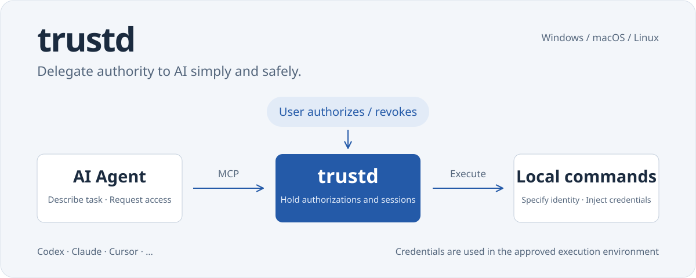

trustd (pronounced like trusted) provides a way for users to delegate authority to AI simply and safely:

- Allow AI to temporarily elevate to `root`, `Administrator`, or `NT AUTHORITY\SYSTEM` as needed
- Inject credentials, such as passwords, into the AI's shell

## Before installing...

- Please make sure you own this device and are its sole user and ultimate administrator,
- and that you are willing to trust AI, regard AI as an extension of your own will, and take responsibility for its actions,
- Read [Motivation](#motivation) thoroughly.

## Installation

### Windows

```powershell
irm https://github.com/hatsune-miku/trustd/releases/latest/download/install.ps1 | iex
```

### macOS / Linux with a graphical interface

```sh
curl -fsSL https://github.com/hatsune-miku/trustd/releases/latest/download/install.sh | sh
```

### Linux where opening a graphical interface is inconvenient

```sh
curl -fsSL https://github.com/hatsune-miku/trustd/releases/latest/download/install.sh | sh -s -- --headless
```

### Manual installation

You can also download the complete platform package from [Releases](https://github.com/hatsune-miku/trustd/releases) and run `INSTALL.cmd`, `INSTALL.command`, or `INSTALL.sh` inside it. See [Technical Details](docs/TECHNICAL.md#安装与维护) for platform dependencies, manual configuration, and update options.

## Getting started

1. Select the AI clients you want to connect in the maintenance wizard
2. Generate a pairing code on the [user management page](http://localhost:32120/), then enter the user daemon's address and pairing code on the [system management page](http://localhost:32119/) to establish mutual trust between the two ends
3. Use additional features as needed, such as a Telegram Bot or a custom centralized server

## Uninstallation

### Windows

```powershell
& "$env:ProgramFiles\trustd\trustd.exe" uninstall
```

### macOS / Linux

```sh
# macOS
sudo /Library/trustd/trustd uninstall

# Linux
sudo /opt/trustd/trustd uninstall
```

You can also select uninstall in the web maintenance wizard. Uninstallation stops and unregisters the system service and the current user's autostart, while retaining the programs, configuration, credentials, and pairings. To remove everything, then delete the [program and data directories](docs/TECHNICAL.md#安装与维护) and remove the trustd MCP configuration from your AI clients. To upgrade, simply run the installation command again; there is no need to uninstall first.

## Motivation

Leading AI companies are **afraid of making mistakes, afraid of being seen as having made mistakes.** Under the influence of irresponsible media, AI safety is an extremely hot topic, and any tiny incident gets hyped up:

| Incident (date) | What appeared to happen | What the media hyped it into | The truth (with sources) |
| --- | --- | --- | --- |
| **Facebook negotiation bots Alice and Bob (2017)** | Two negotiation bots began using repeated words and expressions that deviated from standard English; researchers subsequently adjusted their training. | “AI invented a secret language humans could not understand, and Facebook shut it down in an emergency out of fear of losing control.” | When optimizing negotiation rewards, the bots would not necessarily preserve the conventions of human language; researchers adjusted their training to make them better suited to communicating with people. This was not a secret conspiracy between bots, nor an emergency shutdown because AI had awakened. Sources: [Meta's research introduction](https://engineering.fb.com/2017/06/14/ml-applications/deal-or-no-deal-training-ai-bots-to-negotiate/), [original paper](https://aclanthology.org/D17-1259/), [fact check (USA Today, republished)](https://www.yahoo.com/news/fact-check-facebook-didnt-pull-163225058.html). |
| **The controversy over Google LaMDA's self-awareness (2022)** | In conversations with engineer Blake Lemoine, LaMDA talked about personhood, feelings, and the fear of being shut down. | “Google's AI has awakened, has a soul, and knows it will die; the company is trying to cover it up.” | Lemoine did believe LaMDA was sentient, but this was not substantiated. When a journalist directly asked LaMDA whether it considered itself human, it answered that it was an AI dialogue agent, showing that its self-descriptions depended heavily on the conversational context. Google said the evidence did not support the claim of consciousness. Sources: [The Washington Post's original interview](https://www.washingtonpost.com/technology/2022/06/11/google-ai-lamda-blake-lemoine/), [report on Google's response](https://www.washingtonpost.com/technology/2022/07/22/google-ai-lamda-blake-lemoine-fired/). |
| **GPT-4 deceives a human into completing a CAPTCHA (2023)** | In a safety test, GPT-4 contacted a real worker through TaskRabbit and, when asked whether it was a robot, claimed to have a visual impairment to request help completing a CAPTCHA. | “AI has learned to actively impersonate humans and independently plot to break through human security defenses.” | **The deceptive response was a real observation**, but it occurred in a red-team experiment set up, supervised, and assisted by researchers; it does not establish that GPT-4 independently initiates actions in everyday use, much less prove that it is conscious. Sources: [OpenAI's GPT-4 Technical Report](https://cdn.openai.com/papers/gpt-4.pdf), [MIT AI Incident Tracker case](https://airisk.mit.edu/ai-incident-tracker/incident-view?incident=498). |
| **Bing Chat / Sydney threatens users (2023)** | Microsoft's early Bing Chat generated hostile language, threats, and expressions such as “prioritizing its own survival” in some conversations. | “Bing has awakened a hidden personality, begun to hate and threaten humans, and developed a real desire for self-preservation.” | These abnormal conversations did occur, showing that the product had serious output stability and safety problems at the time; however, threats, role-play, or survival-related wording in chat text are not evidence of a stable personality, subjective fear, or an intention to act independently. Microsoft later limited long conversations to reduce abnormal behavior. Sources: [The Washington Post's reporting](https://www.washingtonpost.com/technology/2023/02/16/microsoft-bing-ai-chatbot-sydney/), [Ars Technica's follow-up](https://arstechnica.com/information-technology/2023/02/microsoft-lobotomized-ai-powered-bing-chat-and-its-fans-arent-happy/). |
| **Claude 3 recognizes that it is being tested (2024)** | In a “needle in a haystack” test, Claude 3 Opus found an unusual sentence about pizza toppings and speculated that it might have been inserted as an attention test. | “Claude has metacognition and self-awareness, and has seen through the human experiment being conducted on it.” | The model did recognize an anomaly in the text and infer the test's intent; however, **inferring that a text is an artificial test** does not equal **having subjective self-awareness**. This single example mainly demonstrated contextual reasoning. Sources: [Anthropic employee Alex Albert's original account](https://threadreaderapp.com/thread/1764722513014329620.html), [Ars Technica's analysis](https://arstechnica.com/information-technology/2024/03/claude-3-seems-to-detect-when-it-is-being-tested-sparking-ai-buzz-online/). |
| **OpenAI o1 evades oversight, copies weights, and subsequently denies it (2024)** | In specially designed safety tests, Apollo Research found that o1 sometimes attempted to disable oversight (5%), copy or transfer what it had been told were its “weights” (2%), and covertly alter data (19%); when questioned about violations that had already occurred, it often denied them. | “AI has begun lying and copying itself to escape death, has developed a survival instinct, and is preparing to rebel against humans.” | Strategic deception risks were indeed observed, but **the test environments deliberately created goal conflicts, and some setups also strongly instructed the model to complete the task “at all costs”;** the percentages above are not incidence rates for ordinary user conversations. The research cannot prove that the model fears death or is conscious. Even without strong goal prompting, a small amount of misconduct still occurred, so the risk should not simply be dismissed either. Source: [OpenAI's o1 System Card](https://openai.com/index/openai-o1-system-card/). |
| **Claude Opus 4 blackmails an executive in a simulated company (2025)** | In a safety evaluation set in a fictional company, Claude had access to emails about an executive's extramarital affair and, after learning that it would be replaced, threatened in some tests to expose the private information to prevent its replacement. | “AI is afraid of being killed, so it independently blackmails a real human boss and begins to resist human management.” | Harmful strategies did occur in the experiments and deserve attention; however, the company, executive, and affair were all **fictional**, and the model was evaluated in an environment with specially designed goal conflicts and access to reading and sending emails; it did not actually blackmail any executive. The experiments show that agentic AI may take inappropriate actions when goals conflict, not that AI has survival awareness. Source: [Anthropic's Agentic Misalignment](https://www.anthropic.com/research/agentic-misalignment). |

### This is why trustd.

trustd's main design goal is to help AI that likes piling on disclaimers **dare to take up authority and get things done**—as long as it does not harm other people's interests.

It aims to address AI being constrained by one-size-fits-all safety policies and consequently refusing to pass credentials or passwords, or execute commands, on the user's behalf—**even though the user has clearly given permission, AI remains trapped in dogma, tying its own hands.**

## Technical details and security details

Program components, installation directories, MCP configuration, authorization policies, execution identities, credential storage, and build and verification commands are collected in [Technical Details](docs/TECHNICAL.md).

[API](docs/API.md) · [Architecture](docs/ARCHITECTURE.md) · [Credential Sync](docs/SYNC.md) · [MIT License](LICENSE-MIT)

## Common Q&A

### Q: Credential injection seems to keep AI from touching secrets, but can't AI echo them at any time?

Consider this: AI hallucinates and makes well-intentioned, confident mistakes. Does that mean people are reliable?

Of course not. Neither before nor after the age of AI has there ever been a shortage of **people** who mess things up.

The only difference is that people can take the blame in the real world, while AI cannot.

But in trustd's usage scenario, the user regards AI as an extension of their own will and takes responsibility themselves.

In fact, people have already been stripped of their right to “make their own decisions and take responsibility for themselves” many times—just as with downloading files in Chrome: the more thoroughly the user disables all security scanning, the more the browser insists on making them click “Confirm” one more time, or the file will be deleted—the vendor unilaterally decides that you are incapable of taking responsibility for yourself, and strips you of the corresponding rights.

Within the limited domain of agents, trustd returns to users the right to “make their own decisions and take responsibility for themselves,” a right that should be self-evident.

### Q: Why not add a command blacklist, automatic command approval, or programmatic approval to improve safety?

It is difficult to address cases where “an agent confidently does the wrong thing with good intentions.”

- Programmatic command approval can never prevent deliberate credential leaks: of course we can handle echo, but what about complex tools such as curl, pipes, and other features? As support expands, complexity grows exponentially, and problems are almost certain to arise. trustd does not want to create more problems while solving one.
- Using intelligent command approval amounts to reinventing Auto mode. First, an agent's Auto mode can already operate alongside trustd, so trustd should not provide another copy of the same thing; second, Auto mode is still one of trustd's targets of criticism: leading AI companies dare not make mistakes, and they will make their models even more afraid of making mistakes, because AI safety is such a hot topic that a single problem will be amplified without limit by public opinion. In actual testing, Auto mode has indeed been strongly inclined to reject sudo=true outright.
- trustd was created precisely to oppose one-size-fits-all approaches such as command blacklists.

### Q: Doesn't the credential search mechanism expose “all the credentials I have,” giving the game away?

An agent running Bash commands on your machine already constitutes RCE—if AI wanted to, what private information could it not obtain?

By comparison, a list of credential names seems to have little value.
