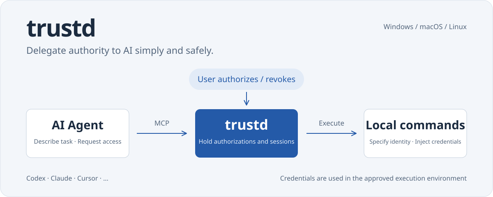

## Other languages?

[中文](README.md)

---



trustd (pronounced "trusted") gives you a simple, safe way to hand authority to AI without being interrupted all the time:

- Let AI temporarily elevate to `root`, `Administrator`, or `NT AUTHORITY\SYSTEM` when it needs to
- Inject credentials, such as passwords, into the AI's shell
- Let AI run commands, transfer files, and run long tasks on your other devices

## Before you install...

- Make sure you own this device and are its only user and ultimate administrator,
- and that you are willing to trust AI, treat it as an extension of your own will, and take responsibility for what it does.

## Install

### Windows

On Windows, we strongly recommend **uninstalling the MSIX (Microsoft Store) version of PowerShell, if you have it,** before installing. The Store version has many problems and does not work with trustd.

```powershell
# Uninstall the Microsoft Store version of PowerShell
Get-AppxPackage -Name Microsoft.PowerShell | Remove-AppxPackage

# Install the regular version of PowerShell
& ([scriptblock]::Create((irm https://aka.ms/install-powershell.ps1))) -UseMSI -Quiet
```

Then install trustd itself:

```powershell
irm https://github.com/hatsune-miku/trustd/releases/latest/download/install.ps1 | iex
```

### macOS / Linux with a desktop

```sh
curl -fsSL https://github.com/hatsune-miku/trustd/releases/latest/download/install.sh | sh
```

### Linux where a desktop is not available

```sh
curl -fsSL https://github.com/hatsune-miku/trustd/releases/latest/download/install.sh | sh -s -- --headless
```

### Manual installation

You can also download the full package for your platform from [Releases](https://github.com/hatsune-miku/trustd/releases) and run the `INSTALL.cmd`, `INSTALL.command`, or `INSTALL.sh` inside it. Platform requirements, manual configuration, and update options are described in [Technical details](docs/TECHNICAL.md#安装与维护).

## Getting started

1. Deploy your own backend (see [Backend protocol](docs/SYNC.md#部署参考实现)) and create a passkey with the setup code. One backend serves exactly one device owner.
2. Run the maintenance wizard on each device, enter the backend address, and select the AI clients to connect (Codex, Claude Code, Claude Desktop, Cursor, and others). After installation, approve the device with one passkey tap on the backend page. Devices of the same device owner trust each other automatically and share one credential vault, and the user and system processes are already paired.
3. Open the [management page](http://localhost:32120/) and sign in with the same passkey. Headless servers can join with `trustd join <backend address>`; if the backend is unreachable, use `trustd login-url` to sign in as a fallback.

## Remote execution

The devices that join your backend form your device network. Once an AI is authorized on any one of them, it can work on the others:

- **Run commands**: open a session on the target device and run commands as the regular user or as administrator / root, using that device's credentials.
- **Long tasks**: submit time-consuming work as a task; it keeps running through network drops and after the AI client closes. The AI can wait for a task to finish instead of polling, and the output stays on the target device, where it can be processed or compressed before only the needed parts are fetched.
- **File transfer**: copy files between this device and the target. The two trustd instances move and verify the data themselves, so it never passes through the AI or uses up the conversation's tokens.
- **Subagents**: the AI can hand a whole piece of work to a subagent that carries it out on the target device. The subagent thinks on this device and acts on the target; long output stays with the subagent and on the target, and only a summary reaches the main conversation.

Every device connects out to your backend, so no ports need to be opened and the devices never need to reach each other directly. Connections are end-to-end encrypted; the backend only relays them and cannot see commands or results. Devices of the same device owner trust each other by default; for exceptions, the backend page lets you withdraw, in one direction, a device's right to run commands at all or only its administrator / root identity. The 远端主机 (Remote hosts) section of the management page lets you view and work with tasks, files, and logs by hand. See [Remote execution](docs/REMOTE.md) for details.

## Uninstall

### Windows

```powershell
& "$env:ProgramFiles\trustd\trustd.exe" uninstall
```

### macOS / Linux

```sh
# macOS
sudo /Library/trustd/trustd uninstall

# Linux
sudo /opt/trustd/trustd uninstall
```

## Motivation

Uncontrolled AI is certainly dangerous, but that is no reason to sacrifice the everyday experience of ordinary users.

trustd's main design goal is to let AI, which today is already bound in shackles and chains, **dare to take up authority and get things done**, as long as it does not harm anyone else's interests.

## Technical and security details

The programs that make up trustd, installation directories, MCP configuration, authorization policy, execution identities, credential storage, and build and verification commands are all described in [Technical details](docs/TECHNICAL.md).

[API](docs/API.md) · [Architecture](docs/ARCHITECTURE.md) · [Credential sync](docs/SYNC.md) · [Remote execution](docs/REMOTE.md) · [MIT License](LICENSE-MIT)

The linked documents are written in Chinese.
