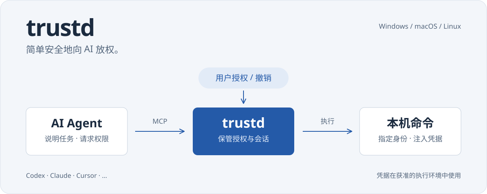

## Other languages?

[English](README.en.md)

---



trustd (音同 trusted) 提供一种方式，让用户能简单、安全、不被打扰地向 AI 放权：

- 让 AI 能按需、临时提权为 `root` 或 `Administrator` 或 `NT AUTHORITY\SYSTEM`
- 在 AI 的 Shell 中注入凭据，例如密码等

## 安装之前...

- 请确保你拥有此设备的所有权、是此设备唯一的用户、终极的管理者，
- 并且你愿意信任 AI、将 AI 视为你自身意志的延申，并对 AI 的行为负责。

## 安装

### Windows

对于 Windows，安装之前强烈建议 **卸载 MSIX 版 PowerShell（如果有）。** 来自微软商店的版本存在诸多问题，与 trustd 也不兼容。

```powershell
# 卸載微软商店版 PowerShell
Get-AppxPackage -Name Microsoft.PowerShell | Remove-AppxPackage

# 安装正常版 PowerShell
& ([scriptblock]::Create((irm https://aka.ms/install-powershell.ps1))) -UseMSI -Quiet
```

然后，再正式安装 trustd：

```powershell
irm https://github.com/hatsune-miku/trustd/releases/latest/download/install.ps1 | iex
```

### macOS / 带图形界面的 Linux

```sh
curl -fsSL https://github.com/hatsune-miku/trustd/releases/latest/download/install.sh | sh
```

### 不方便开启图形界面的 Linux

```sh
curl -fsSL https://github.com/hatsune-miku/trustd/releases/latest/download/install.sh | sh -s -- --headless
```

### 手动安装

也可从 [Releases](https://github.com/hatsune-miku/trustd/releases) 下载完整平台包，运行其中的 `INSTALL.cmd`、`INSTALL.command` 或 `INSTALL.sh`。平台依赖、手动配置和更新选项见 [技术细节](docs/TECHNICAL.md#安装与维护)。

## 开始使用

1. 部署你自己的后端（见 [后端协议](docs/SYNC.md#部署参考实现)），用初始化码创建通行密钥。一个后端只服务一位主人。
2. 在每台设备上运行维护向导，填写后端地址，勾选需要接入的 AI 客户端；安装后在后端页面按一次通行密钥批准即可。同一主人的设备自动互相信任，用户进程与系统进程也已自动配对。
3. 打开 [管理页](http://localhost:32120/)，用同一把通行密钥登录。无头服务器可用 `trustd join <后端地址>` 加入，后端无法访问时用 `trustd login-url` 应急登录。

## 卸载

### Windows

```powershell
& "$env:ProgramFiles\trustd\trustd.exe" uninstall
```

### macOS / Linux

```sh
# macOS
sudo /Library/trustd/trustd uninstall

# Linux
sudo /opt/trustd/trustd uninstall
```

## 动机

不受控的 AI 固然具有危险性，但正常用户的正常使用体验不能因此成为牺牲品。

trustd 的主要设计目标，是让如今已经戴上枷锁与镣铐的 AI **敢于接过权柄并做事**——只要没有损害他人的利益。

## 技术细节、安全细节

程序组成、安装目录、MCP 配置、授权策略、执行身份、凭据存储、构建与验证命令集中在 [技术细节](docs/TECHNICAL.md)。

[API](docs/API.md) · [架构](docs/ARCHITECTURE.md) · [凭据同步](docs/SYNC.md) · [远端执行与 Codex](docs/REMOTE.md) · [MIT License](LICENSE-MIT)
