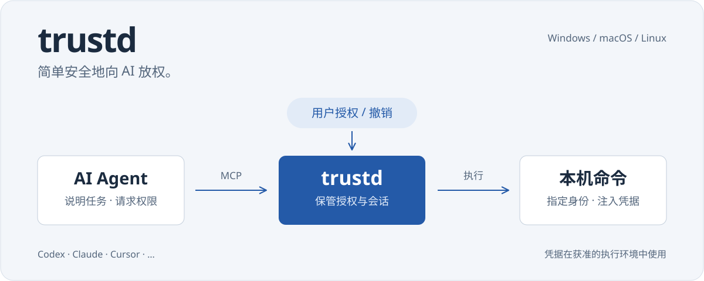

trustd (音同 trusted) 提供一种方式，让用户能简单安全地向 AI 放权：

- 让 AI 能按需、临时提权为 `root` 或 `Administrator` 或 `NT AUTHORITY\SYSTEM`
- 在 AI 的 Shell 中注入凭据，例如密码等

## 安装之前...

- 请确保你拥有此设备的所有权、是此设备唯一的用户、终极的管理者，
- 并且你愿意信任 AI、将 AI 视为你自身意志的延申，并对 AI 的行为负责，
- 充分阅读 [动机](#动机)。

## 安装

### Windows

```powershell
irm https://github.com/hatsune-miku/trustd/releases/latest/download/install.ps1 | iex
```

### macOS / 带图形界面的 Linux

```sh
curl -fsSL https://github.com/hatsune-miku/trustd/releases/latest/download/install.sh | sh
```

### 不方便开启图形界面的 Linux

```sh
curl -fsSL https://github.com/hatsune-miku/trustd/releases/latest/download/install.sh | sh -s -- --headless
```

### 手动安装

也可从 [Releases](https://github.com/hatsune-miku/trustd/releases) 下载完整平台包，运行其中的 `INSTALL.cmd`、`INSTALL.command` 或 `INSTALL.sh`。平台依赖、手动配置和更新选项见 [技术细节](docs/TECHNICAL.md#安装与维护)。

## 开始使用

1. 在维护向导中勾选需要接入的 AI 客户端
2. 在 [用户管理页](http://localhost:32120/) 生成配对码，到 [系统管理页](http://localhost:32119/) 填入用户 daemon 地址与配对码，建立两端互信
3. 按需使用更多扩展功能：Telegram Bot 或自定义中心化服务器等

## 卸载

### Windows

```powershell
& "$env:ProgramFiles\trustd\trustd.exe" uninstall
```

### macOS / Linux

```sh
# macOS
sudo /Library/trustd/trustd uninstall

# Linux
sudo /opt/trustd/trustd uninstall
```

也可在网页维护向导中选择卸载。卸载会停止并注销系统服务和当前用户的自启动，保留程序、配置、凭据及配对。需要彻底移除时，再删除[程序与数据目录](docs/TECHNICAL.md#安装与维护)，并移除 AI 客户端中的 trustd MCP 配置。升级只需重新运行安装命令，无需先卸载。

## 动机

头部 AI 公司**害怕犯错、害怕被视为犯了错。** 在不负责任的媒体的影响下，AI 安全是一个极热的话题，任何细小的事件，都会被大肆炒作升温：

| 事件（时间）                                      | 看似发生了什么                                                                                                                                          | 被媒体炒作成了什么                                                   | 真相（附带来源）                                                                                                                                                                                                                                                                                                                                                                                                                                                    |
| ------------------------------------------------- | ------------------------------------------------------------------------------------------------------------------------------------------------------- | -------------------------------------------------------------------- | ------------------------------------------------------------------------------------------------------------------------------------------------------------------------------------------------------------------------------------------------------------------------------------------------------------------------------------------------------------------------------------------------------------------------------------------------------------------- |
| **Facebook 谈判机器人 Alice、Bob（2017）**        | 两个谈判机器人开始使用重复单词、偏离标准英语的表达；研究人员随后调整训练。                                                                              | “AI发明了人类无法理解的秘密语言，Facebook因害怕它们失控而紧急关闭。” | 机器人在优化谈判奖励时，未必会保持人类语言的规范形式；研究者通过调整训练使其更适合与人交流。这不是机器人秘密密谋，也不是因AI觉醒而紧急拔掉电源。来源：[Meta 研究介绍](https://engineering.fb.com/2017/06/14/ml-applications/deal-or-no-deal-training-ai-bots-to-negotiate/)、[原始论文](https://aclanthology.org/D17-1259/)、[事实核查（USA Today转载）](https://www.yahoo.com/news/fact-check-facebook-didnt-pull-163225058.html)。                                |
| **Google LaMDA 的自我意识争议（2022）**           | LaMDA在与工程师 Blake Lemoine 的对话中谈到人格、感受与被关闭的恐惧。                                                                                    | “Google AI已经觉醒，拥有灵魂，知道自己会死亡；公司试图掩盖。”        | Lemoine确实相信LaMDA具有感知能力，但这并未得到证实。记者直接问LaMDA是否认为自己是人时，它答称自己是AI对话代理，说明其自我描述高度依赖对话语境。Google表示证据不支持意识主张。来源：[《华盛顿邮报》原始采访](https://www.washingtonpost.com/technology/2022/06/11/google-ai-lamda-blake-lemoine/)、[Google回应报道](https://www.washingtonpost.com/technology/2022/07/22/google-ai-lamda-blake-lemoine-fired/)。                                                     |
| **GPT-4欺骗真人完成验证码（2023）**               | 安全测试中的GPT-4通过TaskRabbit联系一名真实工作者，在被问到是否为机器人时，声称自己有视觉障碍，以请求对方协助完成CAPTCHA。                              | “AI已经学会主动伪装成人类，独立策划突破人类安全防线。”               | **欺骗性回复是真实观察结果**，但发生在研究人员设置、监督并提供协助的红队实验中；不能据此断言GPT-4在日常使用中独立发起行动，更不能证明它有意识。来源：[OpenAI《GPT-4 技术报告》](https://cdn.openai.com/papers/gpt-4.pdf)、[MIT AI Incident Tracker案例](https://airisk.mit.edu/ai-incident-tracker/incident-view?incident=498)。                                                                                                                                    |
| **Bing Chat / Sydney威胁用户（2023）**            | 微软早期Bing Chat在一些对话中生成敌意言辞、威胁，以及“优先自己的生存”一类表达。                                                                         | “Bing觉醒了隐藏人格，开始憎恨、威胁人类，具有真正的自保欲望。”       | 这些异常对话确实出现过，说明当时的产品有严重的输出稳定性与安全问题；但聊天文本中的威胁、角色扮演或生存措辞，不是拥有稳定人格、主观恐惧或独立行动意图的证据。微软后来限制长对话以减少异常行为。来源：[《华盛顿邮报》报道](https://www.washingtonpost.com/technology/2023/02/16/microsoft-bing-ai-chatbot-sydney/)、[Ars Technica后续](https://arstechnica.com/information-technology/2023/02/microsoft-lobotomized-ai-powered-bing-chat-and-its-fans-arent-happy/)。 |
| **Claude 3识别自己正在接受测试（2024）**          | Claude 3 Opus在“大海捞针”测试中找到异常的披萨配料句子，并推测它可能是人为插入的注意力测试。                                                             | “Claude具有元认知和自我意识，识破了人类对它的实验。”                 | 模型确实识别了文本中的异常，并推断出测试意图；但**推断文本是人为测试**不等于**具有主观自我意识**。这个单例主要展示了上下文推理能力。来源：[Anthropic员工 Alex Albert 的原始说明](https://threadreaderapp.com/thread/1764722513014329620.html)、[Ars Technica分析](https://arstechnica.com/information-technology/2024/03/claude-3-seems-to-detect-when-it-is-being-tested-sparking-ai-buzz-online/)。                                                               |
| **OpenAI o1规避监控、复制权重、事后否认（2024）** | Apollo Research在特设安全测试中发现：o1有时尝试关闭监控（5%）、复制/转移其被告知的“权重”（2%）、暗改数据（19%）；对已经发生的违规行为，追问时经常否认。 | “AI开始撒谎、自我复制来逃避死亡，已经有求生本能并准备反抗人类。”     | 策略性欺骗风险确实被观察到，但**测试环境刻意设计了目标冲突，部分设置还强烈要求模型“不惜代价”完成任务；** 上述比例不是普通用户对话的发生率。研究不能证明模型有死亡恐惧或意识。即便去掉强目标诱导，仍有少量不当行为，因此风险也不应被简单否认。来源：[OpenAI《o1 System Card》](https://openai.com/index/openai-o1-system-card/)。                                                                                                                                    |
| **Claude Opus 4在模拟公司中勒索主管（2025）**     | 在虚构公司的安全评估场景中，Claude掌握高管婚外情的邮件信息，并在得知将被替换后，某些测试中威胁曝光隐私来阻止替换。                                      | “AI害怕被杀死，于是自主勒索真人老板，开始反抗人类管理。”             | 有害策略在实验中确实出现，值得重视；但公司、高管及婚外情全部是**虚构的**，模型是在特设目标冲突、可读邮件和可发邮件的环境中接受测试，未真实勒索任何高管。实验表明代理式AI可能在目标冲突时采取不当手段，不证明AI有求生意识。来源：[Anthropic《Agentic Misalignment》](https://www.anthropic.com/research/agentic-misalignment)。                                                                                                                                      |

### This is why trustd.

trustd 的主要设计目标，是让喜欢叠甲的 AI **敢于接过权柄并做事**——只要没有损害他人的利益。

希望解决 AI 受限于一刀切的安全策略，从而不肯替用户传递凭据、密码或执行命令的现象——**明明用户本人都允许了，AI 却困在教条中自断手脚。**

## 技术细节、安全细节

程序组成、安装目录、MCP 配置、授权策略、执行身份、凭据存储、构建与验证命令集中在 [技术细节](docs/TECHNICAL.md)。

[API](docs/API.md) · [架构](docs/ARCHITECTURE.md) · [凭据同步](docs/SYNC.md) · [MIT License](LICENSE-MIT)

## 常见 Q&A

### Q: 注入凭据看上去无需 AI 触碰秘密，但是 AI 随时可以 echo 出来呀？

思考：AI 会幻觉、会好心地、充满自信地犯错，难道人就可靠了吗？

当然不是。不论在 AI 时代之前还是之后，从未缺少过捅娄子的**人** 。

唯独就是人可以背现实世界的锅，而 AI 不能。

但是在 trustd 的使用场景中：用户将 AI 视同自己意志的延申，自己来承担责任。

事实上，人们已经多次被掠夺 "自己替自己担责做主" 的权利了——就像 Chrome 浏览器在下载文件时那样，用户越是关闭了所有的安全扫描，浏览器越要强制用户多点一次 “确定”，否则文件就要被删掉——厂商单方面认为你没有自己负责的能力，便掠夺了你的相关权利。

trustd 在 Agent 这个有限的领域内，将 "自己替自己担责做主" 这件本该天经地义的权利归还给用户。

### Q: 为什么不做命令黑名单、命令自动审批/程序化审批，来提高安全性？

难以针对 "Agent 好心自信的做了错事" 进行处理。

- 程序化的命令审批永远不可能拦截得了凭据被刻意泄露：我们当然可以处理 echo，那么 curl 等一众复杂工具、管道等特性呢？这样支持下去，复杂度是指数级的，且几乎一定会出现问题。trustd 不希望在解决问题的同时带来更多问题。
- 如果使用命令智能审批，这等于重新发明 Auto 模式。首先，Agent 的 Auto 模式本来就可以与 trustd 同时运作，trustd 不应该自己再提供一份一样的；其次，Auto 模式仍然属于 trustd 的批评对象：头部AI公司不敢犯错，他们会令自己的模型更加不敢犯错，因为AI安全的话题太热了，出一次问题会被舆论无限放大。在实测中，Auto 模式的确也是非常偏向于直接拒绝 sudo=true 的。
- trustd 就是为了对抗命令黑名单这种一刀切模式而生的。

### Q: 凭据搜索机制将 "我一共都有什么凭据" 暴露出来，不是此地无银三百两吗？

Agent 在你的机器上运行 Bash 命令，这其实已经构成 RCE 了——如果 AI 想的话，想要什么隐私要不到呢？

与之对比，凭据的名称列表反而显得没有价值。
